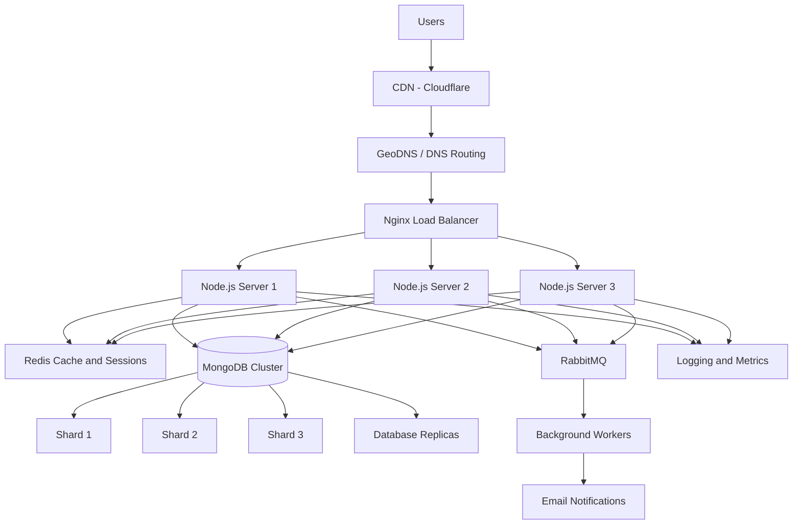

# System-Design-Notes
My learning journey and notes on System Design.

# Chapter 1: Scale from Zero to Millions of Users

## Section 1: Single Server Setup

### 1. Single Server Setup
- Initially, all application components run on a single server.
- Components include web application, backend, database, and cache.
- Suitable for applications with low traffic.

### 2. Request Flow
1. Users enter a domain name in their browser.
2. DNS resolves the domain into an IP address.
3. The browser connects to the web server.
4. The web server receives the HTTP request.
5. The server returns an HTML or JSON response.

### 3. Traffic Sources

**Web Applications**
- Use HTML, CSS, and JavaScript for the frontend.
- Use Node.js, Python, or Java for backend logic.

**Mobile Applications**
- Communicate with web servers using HTTP.
- Commonly exchange data in JSON format.

## Section 2: Database Separation

### 4. Database Separation
- The database is moved to a dedicated server as the user base grows.
- Web and database servers operate independently.
- Allows independent scaling of both components.

### 5. Independent Scaling
- Increasing the capacity of different system components separately.
- Web servers and database servers can be upgraded independently.
- Example: Adding more web servers without changing the database server.

### 6. Relational Databases (SQL)
- Store structured data in tables with rows and columns.
- Support relationships between tables.
- Examples: MySQL and PostgreSQL.

### 7. Non-Relational Databases (NoSQL)
- Store data using different data models.
- Support flexible data structures.
- Examples: MongoDB, Redis, Cassandra, and Neo4j.

### 8. Types of NoSQL Databases

| Type | Description | Example |
|---|---|---|
| Key-Value Store | Stores key-value pairs | Redis |
| Document Store | Stores data in documents | MongoDB |
| Graph Database | Stores nodes and relationships | Neo4j |
| Column Store | Organizes data by columns | Cassandra |

### 9. When to Use NoSQL?
- When very low latency is required.
- When data is unstructured or has a flexible structure.
- When serialization and deserialization are needed.
- When storing massive amounts of data.

## Important Terminologies

| Term | Definition |
|---|---|
| Scaling | Increasing system capacity |
| DNS | Resolves domain names into IP addresses |
| HTTP | Communication protocol between client and server |
| JSON | Lightweight data exchange format |
| Hosting | Making an application available on the internet |
| Server | A computer that processes requests |
| Latency | Time delay in communication |
| Serialization | Converting data into a transferable format |
| Deserialization | Converting serialized data into a usable format |

## Section 3: Vertical vs Horizontal Scaling

### 1. Vertical Scaling (Scale Up)
- Increases resources (CPU, RAM, storage) of an existing server.
- Improves the capacity and performance of that server.
- Has hardware limitations.
- Does not provide built-in redundancy.

**Example:** Upgrading a server from 4 GB RAM to 16 GB RAM.

### 2. Horizontal Scaling (Scale Out)
- Adds more servers to the existing server pool.
- Distributes the workload across multiple servers.
- Suitable for large-scale applications.
- Provides better redundancy and scalability.

**Example:** Adding three Node.js servers instead of running the application on a single server.

### Key Difference

- **Vertical Scaling:** Makes one server more powerful.
- **Horizontal Scaling:** Adds more servers to handle increased traffic.

## Section 4: Load Balancer

A **Load Balancer** distributes incoming network traffic among multiple servers.

### Benefits

#### 1. Redundancy
- If one server goes offline, traffic is redirected to other available servers.
- Keeps the application running even if a server fails.

**Example:** If Server 1 goes offline, traffic is routed to Server 2.

#### 2. Scalability
- Allows additional servers to be added when traffic increases.
- Helps handle sudden traffic spikes.

**Example:** If website traffic grows, additional servers can be added to handle incoming requests.

### Key Points
- Distributes traffic among multiple servers.
- Improves availability and reliability.
- Supports horizontal scaling.

## Section 5: Database Replication

Database Replication is the process of maintaining copies of a database across multiple servers to improve performance, availability, and reliability.

### Master-Slave Model

#### 1. Master Database
- Handles all write operations.
- Insert, Update, and Delete commands are sent to the Master database.
- Replicates data to Slave databases.

#### 2. Slave Databases
- Primarily handle read operations.
- Receive replicated data from the Master database.
- Distribute read traffic across multiple servers.

### Benefits

1. **Improved Performance:** Multiple Slave databases handle read requests in parallel.
2. **High Availability:** Other healthy Slave databases can handle requests if one fails.
3. **Data Redundancy:** Multiple database copies improve data reliability.

### Failure Handling

- **Slave Failure:** Read requests are redirected to other healthy Slaves. If no Slave is available, reads can temporarily go to the Master.
- **Master Failure:** A healthy Slave can be promoted to become the new Master.
- **Data Recovery:** The new Master may need synchronization or recovery if it does not contain the latest data.

### Key Points
- Master handles write operations.
- Slaves primarily handle read operations.
- Data is replicated from Master to Slaves.
- Database replication improves performance and availability.

## Section 6: Caching

Caching is the process of storing frequently accessed data temporarily in memory to reduce database load and improve application performance.

### How Caching Works
1. The backend first checks the cache for requested data.
2. If data is found (**Cache Hit**), it is returned directly from the cache.
3. If data is not found (**Cache Miss**), the backend fetches it from the database.
4. The fetched data is stored in the cache for future requests.

### Cache vs Database
- **Database:** Stores original and permanent application data.
- **Cache:** Stores frequently accessed data temporarily in memory.
- Cache is much faster than a traditional database.

### Caching Considerations

#### 1. Use Case
- Best for data that is frequently read but rarely modified.

#### 2. Expiration Policy (TTL)
- Defines how long cached data remains in memory.
- Expired data is automatically removed.

#### 3. Consistency
- Ensures cache and database contain updated data.
- Inconsistency occurs when cached data is outdated.

#### 4. Mitigating Failures
- Multiple cache servers can reduce the risk of a Single Point of Failure (SPOF).

#### 5. Eviction Policies
- Remove data when the cache memory becomes full.
- **LRU (Least Recently Used):** Removes the data that has not been accessed for the longest time.

### Benefits
- Reduces database load.
- Improves response time.
- Increases application performance.

### Example
Redis can be used as a caching layer in a MERN application to store frequently requested MongoDB data.

## Section 7: Content Delivery Network (CDN)

A **CDN** is a network of geographically distributed servers that caches and delivers static content (images, CSS, JavaScript) from locations closer to users.

### Workflow
1. User requests static content.
2. The request is directed to a nearby CDN server.
3. If the content is available (**Cache Hit**), it is delivered directly.
4. If unavailable (**Cache Miss**), the CDN fetches content from the Origin Server and caches it.

### Important Terminologies

- **Static Content:** Images, CSS, JavaScript, and other files.
- **Origin Server:** The original server where website content is stored.
- **Cache Hit:** Requested content is found in the CDN cache.
- **Cache Miss:** Requested content is not found in the CDN cache.

### CDN Considerations

1. **Cost:** CDN providers charge for data transfers and usage.
2. **Cache Expiry:** Determines how long cached content remains available.
3. **CDN Fallback:** If the CDN becomes unavailable, clients should be able to request resources from the Origin Server.
4. **Invalidating Files:** Updated files should replace or invalidate old cached versions.

### Using a CDN Worldwide
- A single CDN provider can offer servers across multiple countries.
- Users receive static content from nearby CDN servers.
- There is no need to configure a separate CDN for every country.

### Popular CDN Providers
- Cloudflare
- Amazon CloudFront
- Akamai
- Cloudinary and ImageKit (for image storage, optimization, and delivery)

### Key Benefits
- Faster content delivery.
- Reduced load on the Origin Server.
- Improved website performance.
- Better experience for users worldwide.

## Section 8: Stateless Web Tier

A Stateless Web Tier is an architecture where web servers do not store user session data locally. Instead, session data is stored in a shared datastore such as Redis or a database.

### How It Works
1. A user logs in through Server 1.
2. Session information is stored in shared storage (e.g., Redis).
3. The user's next request may go to Server 2.
4. Server 2 retrieves the session information from the shared storage.
5. The user remains logged in without logging in again.

### Benefits
1. **Easy Horizontal Scaling:** New servers can be added easily because session data is not stored on individual servers.
2. **Auto-Scaling:** Servers can automatically increase or decrease based on traffic.

### Key Difference
- **Stateful:** Each server stores its own session data.
- **Stateless:** Session data is stored in shared storage and accessed by all servers.

### Key Point
Stateless web servers make applications easier to scale because any server can handle a user's request.

## Section 9: Multi-Data Center Setup

Multi-Data Center Setup means deploying an application across multiple geographical locations to improve availability and reduce latency.

### Main Strategies

1. **GeoDNS Routing:** Directs users to the nearest data center based on their geographical location.
2. **Data Replication:** Synchronizes data across multiple data centers to keep data available and consistent.

### Key Considerations

1. **Traffic Redirection:** Use effective tools to route users to the correct data center.
2. **Data Synchronization:** Replicate data across multiple data centers to maintain consistency.
3. **Testing and Deployment:** Use automated tools to keep services consistent across all data centers.

### Key Benefits

- **High Availability:** If one data center fails, another can handle requests.
- **Low Latency:** Users receive responses from nearby data centers.
- **Reliability:** Data is available across multiple locations.

### Key Difference

- **Load Balancer:** Distributes traffic between multiple servers.
- **GeoDNS:** Routes users between different geographical data centers.

## Section 10: Message Queue

A Message Queue is a component that temporarily stores messages and enables asynchronous communication between services.

### Main Components

1. **Producer / Publisher:** Creates messages and sends them to the message queue.
2. **Message Queue:** Stores messages until consumers are ready to process them.
3. **Consumer / Subscriber:** Receives messages from the queue and performs the required tasks.

### How It Works

1. Producer creates a message.
2. Message is sent to the queue.
3. Queue stores the message.
4. Consumer retrieves the message.
5. Consumer processes the message.

### Daily Life Example: Restaurant

- Cashier (Producer): Receives the customer's order.
- Order Ticket Line (Message Queue): Stores orders in a waiting line.
- Kitchen Staff (Consumer): Takes orders and prepares food.

### Asynchronous Communication

Asynchronous communication allows the producer to continue its work without waiting for the consumer to finish processing the message.

### Durability

A durable message queue helps prevent messages from being lost if a consumer temporarily fails or restarts.

### Popular Message Queue Tools

- RabbitMQ
- Apache Kafka
- Amazon SQS

### Key Benefits

- Reduces workload on the main application.
- Supports background processing.
- Handles large numbers of messages.
- Allows services to work independently.

### Key Concept

**Producer → Message Queue → Consumer**

## Section 11: Logging, Metrics, and Automation

These three components help monitor, analyze, and manage an application's performance and health.

### 1. Logging
Logging records events, activities, and errors that occur in an application.

**Purpose:**
- Track application errors.
- Monitor system health.
- Help developers identify and debug problems.

### 2. Metrics
Metrics measure application performance and user activity using numerical data.

**Examples:**
- Number of active users.
- Average response time.
- CPU and memory usage.
- Application error rate.

**Purpose:**
- Analyze system performance.
- Identify performance issues.
- Monitor user activity.

### 3. Automation
Automation means performing repetitive tasks automatically without manual intervention.

**Examples:**
- Automated testing.
- Automatic deployment.
- Automatic scaling based on traffic.

**CI/CD:** A process that automates code testing and application deployment.

### Key Difference

- **Logging:** What happened?
- **Metrics:** How well is the system performing?
- **Automation:** How can tasks be performed automatically?

### Key Benefits
- Easier error detection.
- Better performance monitoring.
- Reduced manual work.
- Faster testing and deployment.

## Section 12: Database Scaling

Database Scaling means improving database capacity and performance to handle more users and data.

### 1. Vertical Scaling (Scale Up)

Vertical Scaling means increasing hardware resources of an existing database server.

**Examples:**
- Increasing RAM.
- Upgrading CPU.
- Increasing storage capacity.

**Drawbacks:**
- Physical hardware limitations.
- High hardware costs.
- Greater risk of a Single Point of Failure (SPOF).

### 2. Horizontal Scaling (Sharding)

Horizontal Scaling means distributing database data across multiple servers called Shards.

**Sharding:** Dividing a large database into smaller, manageable parts called shards.

- Each shard has the same database schema.
- Each shard stores different data.
- Data is distributed using a Sharding Key (e.g., `user_id`).

### Sharding Key

A Sharding Key is a field used to determine which shard will store particular data.

A good sharding key should distribute data evenly across shards.

### Challenges of Sharding

#### 1. Resharding Data
Resharding means redistributing data when:
- A shard runs out of storage.
- Data becomes unevenly distributed.

**Solution: Consistent Hashing**

Consistent Hashing distributes data across servers using a hash ring and minimizes data movement when servers are added or removed.

**Benefits:**
- Reduces data movement.
- Makes adding and removing shards easier.
- Improves scalability.

#### 2. Celebrity Problem (Hotspot)

When a specific shard receives excessive requests, it can become overloaded.

**Solution:** Allocate a dedicated shard for a celebrity or use caching to reduce the load.

#### 3. Joins and Denormalization

Performing JOIN operations across multiple database shards can be difficult and expensive.

**Solution: Denormalization**

Store related data together so queries can retrieve information from a single table or document without accessing multiple shards.

### Key Difference

- **Vertical Scaling:** Increase resources of one server.
- **Horizontal Scaling:** Distribute data across multiple servers.

### Key Point

Sharding improves database scalability by dividing large datasets across multiple servers.

## Chapter 1: Conclusion

### Key Takeaways

1. **Stateless Web Tier:** Store session data in shared storage so any server can handle user requests.
2. **Redundancy:** Build multiple servers at every tier to ensure high availability and prevent single points of failure.
3. **Caching and CDN:** Use caching and Content Delivery Networks (CDNs) to improve application performance and reduce response time.
4. **Database Sharding:** Divide large databases into smaller parts (shards) to handle increasing amounts of data and traffic.
5. **Decoupling Components:** Keep system components independent using techniques like Message Queues for flexibility and scalability.

### Final Summary

These techniques provide a foundation for building scalable, reliable, and high-performance systems that can handle millions of users.

# Project: Scalable E-Commerce System

## 1. Project Overview

A Scalable E-Commerce System is an online shopping application designed to handle increasing numbers of users, requests, and data while maintaining high performance and availability.

**Main Features:**
- User authentication
- Product management
- Shopping cart
- Order management
- Payment processing
- Email notifications

## 2. System Architecture

## 3. Chapter 1 Concepts and Their Implementation

### 1. Single Server Setup
Initially, run the frontend, backend, and database in a basic setup to understand the application architecture.

### 2. Database Separation
Use a dedicated MongoDB server instead of running the database on the application server.

### 3. Vertical vs Horizontal Scaling
- **Vertical Scaling:** Increase CPU and RAM of an existing server.
- **Horizontal Scaling:** Add multiple Node.js server instances to handle more requests.

### 4. Load Balancer
Use Nginx to distribute incoming requests among multiple Node.js servers.

**Benefits:**
- Distributes traffic.
- Improves availability.
- Prevents one server from handling all requests.

### 5. Database Replication
Use MongoDB Replica Sets to maintain multiple copies of database data.

- Primary: Handles write operations.
- Secondary: Replicates data and can serve eligible read operations.
- Automatic failover helps maintain availability.

### 6. Caching
Use Redis to store frequently accessed product data.

**Workflow:**
1. Check Redis for product data.
2. If available (Cache Hit), return cached data.
3. If unavailable (Cache Miss), fetch data from MongoDB.
4. Store the result in Redis for future requests.

### 7. Content Delivery Network (CDN)
Use Cloudflare to deliver static files such as:
- Product images
- CSS files
- JavaScript files

CDN serves cached content from geographically distributed servers.

### 8. Stateless Web Tier
Store user session information in shared storage such as Redis.

Any Node.js server can access the same session data, allowing requests to be handled by different servers.

### 9. Multi-Data Center Setup
Deploy application infrastructure in multiple geographical regions.

- GeoDNS routes users to an appropriate nearby region.
- Data replication helps synchronize information between regions.
- Automated deployment keeps environments consistent.

### 10. Message Queue
Use RabbitMQ for asynchronous background processing.

**Example: Order Processing**
1. User places an order.
2. Backend saves the order.
3. Backend publishes an order event to RabbitMQ.
4. Background workers consume the message.
5. Workers send confirmation emails and process notifications.

### 11. Logging, Metrics, and Automation
- **Logging:** Use Winston to record application events and errors.
- **Metrics:** Use Prometheus and Grafana to monitor performance.
- **Automation:** Use GitHub Actions for automated testing and deployment.

### 12. Database Scaling
Use MongoDB Sharding to distribute large amounts of data across multiple shards.

**Important Concepts:**
- Sharding Key: Determines where data is stored.
- Resharding: Redistributes data when necessary.
- Consistent Hashing: Helps minimize data movement when adding or removing shards.
- Denormalization: Stores related data together to reduce cross-shard queries.

## 4. Example: Complete Order Request Flow

1. User opens the React application.
2. CDN delivers static resources.
3. Load Balancer forwards the API request to an available Node.js server.
4. Server retrieves the user's session from Redis.
5. Backend processes the order.
6. Order is saved in MongoDB.
7. An event is published to RabbitMQ.
8. Background worker sends an order confirmation email.
9. Logging and monitoring systems track application activity.

## 5. Technology Stack

| Component | Technology |
|---|---|
| Frontend | React + Tailwind CSS |
| Backend | Node.js + Express.js |
| Database | MongoDB |
| Cache & Sessions | Redis |
| Load Balancer | Nginx |
| Message Queue | RabbitMQ |
| CDN | Cloudflare |
| Logging | Winston |
| Metrics | Prometheus + Grafana |
| Deployment | Docker + GitHub Actions |

## 6. Development Roadmap

### Phase 1: Basic MERN Application
- Authentication
- Products CRUD
- Shopping Cart
- Order Management

### Phase 2: Performance Optimization
- Redis Caching
- CDN Integration
- Database Indexing

### Phase 3: Horizontal Scaling
- Multiple Node.js Instances
- Nginx Load Balancer
- Stateless Sessions

### Phase 4: Reliability
- Database Replication
- RabbitMQ
- Background Workers

### Phase 5: Advanced Scaling
- Database Sharding
- Logging and Metrics
- Automated Deployment
- Multi-Data Center Architecture

## 7. Final Goal

The goal is to transform a basic MERN e-commerce application into a scalable, reliable, and high-performance system.

**Key Principles:**
- Keep web servers stateless.
- Build redundancy at every tier.
- Use caching and CDNs.
- Scale databases using sharding.
- Decouple services using message queues.

**Note:** Implement these concepts gradually. Not every component is required for a small application; advanced infrastructure should be introduced when the system needs it.

